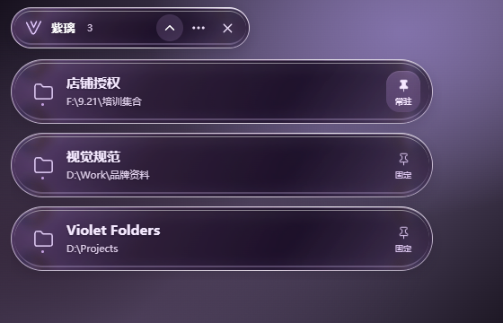

# Violet Folders · 紫璃文件夹

A Windows folder shelf built with **Electron + React + TypeScript**, using [rdev/liquid-glass-react](https://github.com/rdev/liquid-glass-react) for its glass UI. Opening a folder in File Explorer adds an independent purple glass row near the top-left edge of your desktop. Click to return; pin to keep a folder available.

[简体中文](README.md)



Browser preview with example paths. The desktop appearance varies with the background.

## Run the portable app

Run `H:\CZWJJ\release\VioletFolders-1.1.0-win-x64.exe`, or extract `VioletFolders-1.1.0-win-x64.zip` from the same directory and launch the app. The portable package includes Electron, so users do not need Node.js or .NET. Repository users with access can also download it from GitHub Releases.

1. Open a folder in Windows File Explorer. Each detected path gets an independent glass row; duplicate paths are merged.
2. The final folder name is prominent, with the parent path as supporting information. Hover for the complete path.
3. Click to activate the matching Explorer window or reopen a pinned folder that has been closed.
4. Pin a folder to keep it after Explorer closes and across app restarts. Unpinned rows disappear when all corresponding windows close or navigate elsewhere.
5. Fold all rows with the top control. Drag the top area to move the shelf. Gaps stay transparent, with no shared background panel.

The top **×** exits the whole app, leaving Explorer windows open. The menu offers Chinese / English, reset to the top-left corner, and optional start at sign-in, off by default and available in packaged builds. The tray icon also provides expand, collapse, and quit actions. Empty and collapsed states leave only the compact control bar.

| Action | Shortcut |
| --- | --- |
| Expand / collapse globally | `Ctrl` + `Alt` + `F` |
| Close an open menu, otherwise collapse folders | `Esc` |
| Return to or reopen a folder | Click its glass row |

## Glass effect and scope

`liquid-glass-react` provides edge refraction, frosting, and reflected highlights. Elastic displacement is disabled in this app to keep scroll edges stable. It processes web content inside Chromium. CSS filters cannot directly sample other apps or the desktop, so arbitrary desktop refraction is not promised. A browser preview and a transparent desktop window can also have different visual backgrounds.

- Targets Windows 10 / 11 x64. The local verification machine runs Windows 10 22H2; Windows 11 still requires target-machine verification.
- Tracks file-system paths exposed by Windows File Explorer, including drive paths and accessible network shares. Third-party file managers, browsers, and virtual Home views are outside its scope.
- Complete enumeration of background Windows 11 tabs is not guaranteed; it depends on the windows and tabs exposed by the system Shell interface.
- Topmost behavior applies to ordinary desktop windows, with no guarantee over the secure desktop, UAC prompts, lock screen, or exclusive fullscreen apps.
- The current portable build is unsigned. If another app owns the shortcut, use the shelf or tray controls.

## Local data

Pins, language, position, and preferences are stored in `%APPDATA%\Violet Folders\settings.json`. Development and packaged builds use the same application name and settings directory. The running app does not upload folder paths or file contents. Personal settings are excluded from the source and distribution packages.

To remove the app, turn off start at sign-in, quit, and delete its portable files. Delete the settings directory separately if you also want to remove preferences.

## Develop and package

Requires Windows, Node.js 22, and npm. The current app does not require .NET for development.

```powershell
Set-Location H:\CZWJJ
npm install
npm run dev
```

To get the source from GitHub:

```powershell
git clone https://github.com/xietiantian6877-lab/violet-folders.git
Set-Location violet-folders
npm ci
npm run dev
```

```powershell
npm test            # Backend and domain tests
npm run build       # TypeScript checks and Vite build
npm run dist        # Windows x64 portable EXE, ZIP, and checksums
```

The Windows one-command entry point is `.\scripts\build.ps1`. It installs dependencies, runs tests, and invokes the current Electron project's `npm run dist`. Use `-SkipInstall` when dependencies are already installed.

The renderer builds into `dist-renderer/`. Portable packages and SHA-256 checksums go into `release/`. `npm run preview` is a browser UI preview only and does not connect to the real Explorer session.

The UI component is `renderer/App.tsx`, with mounting in `renderer/main.tsx` and material / layout styles in `renderer/style.css`. Electron starts from `electron/main.cjs`; Vite configuration is `vite.config.mts`.

```text
release/
  VioletFolders-1.1.0-win-x64.exe
  VioletFolders-1.1.0-win-x64.zip
  VioletFolders-1.1.0-win-x64.exe.sha256
  VioletFolders-1.1.0-win-x64.zip.sha256
  SHA256SUMS.txt
```

## GitHub releases

GitHub Actions uses Node.js 22 to install with `npm ci`, test, build, and package Windows artifacts. It saves the EXE, ZIP, and checksums. A version tag such as `v1.1.0` creates a GitHub Release or updates the assets of an existing release. Repository permissions determine visibility.

## Preserved WPF source

The earlier C# / WPF app remains in `src/VioletFolders/`, with its .NET tests in `tests/VioletFolders.Tests/` and `tests/VioletFolders.UiTests/`. Use `scripts/build-legacy-wpf.ps1` only to rebuild that earlier app with the .NET 10 SDK; its output lives in `dist/`. The current primary app uses Electron and builds through npm or `scripts/build.ps1`.

The main project uses the MIT License; see [LICENSE](LICENSE). Third-party dependencies retain their respective licenses.
