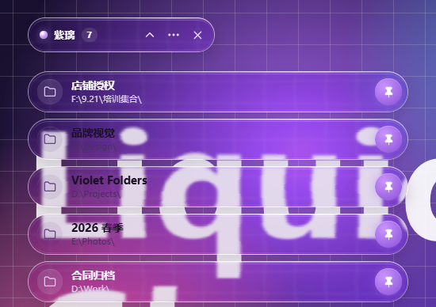
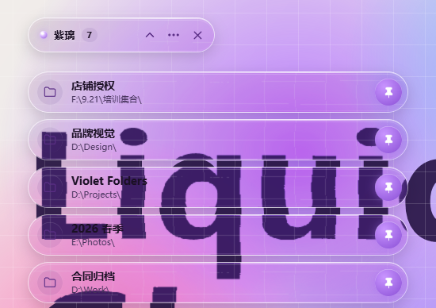
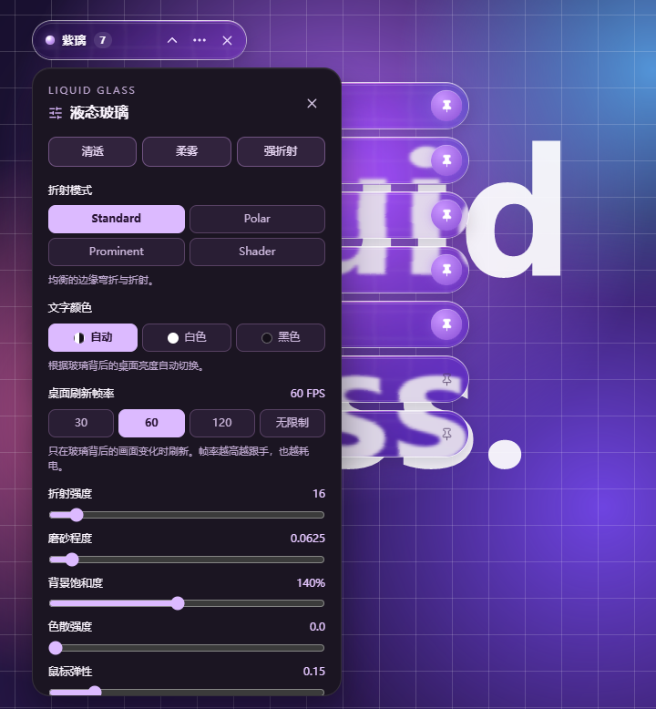

# 紫璃文件夹 · Violet Folders

基于 **Electron + React + TypeScript** 的 Windows 文件夹悬浮工具，玻璃界面使用 [rdev/liquid-glass-react](https://github.com/rdev/liquid-glass-react)。打开资源管理器里的文件夹，屏幕左上角就会出现独立的紫色玻璃条；点击返回，固定后随时重新打开。

[English](README.en.md)



以上截图均为真实 Windows 桌面上 **开启桌面实时折射** 的效果，示例路径为演示数据。

| 浅色背景 · 文字锁定黑色 · 磨砂 0 | 液态玻璃设置 |
| --- | --- |
|  |  |

## 1.3 新变化

- **更流畅**：桌面取样只在玻璃背后的画面真正变化时刷新。屏幕其他位置的视频、动画不再占用资源（实测从约 1 个 CPU 核降到约 2%）。同时修复了“自身重绘 → 被判为桌面变化 → 再次刷新”的循环。
- **帧率可调**：设置里可选 30 / 60 / 120 / 无限制，默认 60。
- **清晰模式**：磨砂程度拉到 0 时不再保留默认模糊，玻璃背后的桌面文字清晰可读。
- **文字颜色可锁定**：自动 / 白色 / 黑色。锁定后不再取样背景亮度。
- **贴边拖动不再抽搐**：拖动改为主进程逐帧限制在工作区内，靠近屏幕边缘时平滑贴边滑动。双击顶部可折叠。
- **长按拖动排序**：长按文件夹条约 0.3 秒即可拖动，其他条目平滑让位；靠近列表上下边缘时自动滚动。排序会保存。
- **全新界面**：更紧凑的玻璃条、圆形文件夹图标、发光常驻按钮。不再显示滚动条，改为上下渐隐。展开 / 收起带逐条错落动画。

## 直接运行

双击 `H:\CZWJJ\release\VioletFolders-1.3.0-win-x64.exe`，或者解压同目录的 `VioletFolders-1.3.0-win-x64.zip` 后运行应用。便携包包含 Electron 运行时和原生捕获模块，使用时无需另装 Node.js、.NET、Visual Studio 或 Windows SDK。有仓库访问权限的用户也可以从 GitHub Release 下载。

1. 正常打开 Windows 文件资源管理器中的文件夹。每个检测到的路径显示为独立玻璃条，相同路径合并。
2. 最后一级文件夹名突出显示，父路径作为辅助信息；悬停查看完整路径。
3. 点击路径切回对应资源管理器窗口；已关闭的固定文件夹会重新打开。
4. 点击图钉常驻。固定路径会在关闭资源管理器和重启应用后保留；未固定条目在对应文件夹全部关闭或导航离开后移除。
5. 顶部按钮可折叠全部条目，拖动顶部区域可移动悬浮位置。条目之间保持透明，没有公共背景面板。

顶部 **×** 退出整个应用，资源管理器窗口保持打开。菜单提供中英文切换、返回左上角和可选的开机启动；开机启动默认关闭，在打包版本中可设置。托盘图标也提供展开、折叠和退出操作。没有文件夹或全部折叠时，只保留紧凑控制条。

| 操作 | 快捷方式 |
| --- | --- |
| 全局展开 / 折叠 | `Ctrl` + `Alt` + `F` |
| 关闭玻璃设置或菜单，否则折叠文件夹 | `Esc` |
| 切回或重新打开文件夹 | 点击对应玻璃条 |

## 玻璃效果与适用范围

1.2 版使用参考项目的 SVG 位移滤镜、RGB 色散和边缘反光。点击顶部菜单中的 **液态玻璃效果**，修改后立即生效并自动保存。

- 四种折射模式：`Standard`、`Polar`、`Prominent`、实验性的 `Shader`。
- 七个滑块：折射强度、磨砂程度、背景饱和度、色散强度、鼠标弹性、圆角半径和紫色着色。
- **浅色背景增强** 可加深玻璃；**桌面实时折射** 控制桌面取样。
- 提供 **清透 / 柔雾 / 强折射** 预设，以及 **恢复默认**。圆角受胶囊尺寸限制，文件夹条最大为 36px，顶部控制条最大为 23px。

桌面折射使用 DXGI Desktop Duplication，不开启会产生黄色捕获边框的 WGC 会话，也不合成独立的鼠标指针。画面经过 D3D11 共享纹理、Electron `sharedTexture` 和 `VideoFrame`，供所有玻璃条共同使用；每条玻璃只把自身及滤镜所需边缘区域绘制到局部 canvas，再应用磨砂、饱和度和折射。原生层持续保留一份最新桌面纹理，并用脏矩形和像素比对判断玻璃背后（含滤镜边缘）是否真正变化；只有变化时才按设置的帧率（默认 60，可设为无限制）发送新帧，窗口移动后补发一帧。不逐帧编码 JPEG，也不通过 IPC 传输像素数组；跨进程共享 GPU 纹理。画面只在本机内存中处理，不录制、不保存、不上传。

原生模块在窗口显示后及每次捕获启动前直接设置 `WDA_EXCLUDEFROMCAPTURE`，读回确认后通过 `DwmFlush` 等待桌面合成更新，避免工具包缓存的保护状态失效；验证失败时不启动捕获。关闭桌面实时折射会停止捕获并释放纹理。系统不支持或采集失败时，使用带稳定深色着色的透明玻璃回退外观，并在设置面板显示状态。

文字与图标会依据背景亮度切换明暗：每 250ms 读取 15 个像素，计入当前饱和度、紫色着色及浅色背景增强，并保留切换缓冲区以减少闪烁。文字阴影已移除，着色与反光位于光学背景上方、清晰文字下方；折射滤镜的互补区域相加保持不透明，避免漏出另一层未处理桌面形成重影。

鼠标弹性默认为 0.15。拉伸与位移会按当前弹性预留显示空间，不再被文件夹列表的边缘裁切。

无鼠标捕获及自身排除要求 Windows 10 2004（内部版本 19041）或更新系统；Windows 11 是待验证目标。浏览器预览使用带文字、网格与图形的示例背景，方便观察边缘弯折，不读取桌面。当前桌面版的玻璃设置固定显示在顶部控制条下方，宽度最高为 340px，并随可用高度滚动。打开面板时预留固定窗口宽度，调节弹性不会再让设置栏左右晃动。

某些驱动会把软件指针直接绘入桌面画面；当无法确认指针独立时，模块丢弃这类帧并保留最近的干净画面，避免把鼠标再折射一遍。这种情况下实时更新可能暂停。

当前捕获支持正常横向的 GPU 桌面输出；旋转显示器或仅提供系统内存画面的环境使用回退外观。

- 目标为 Windows 10 / 11 x64。Windows 10 22H2、2560×1440 桌面已完成 DXGI 自身排除、首帧、鼠标穿透、背压及打包版自动启动验证。桌面复制随画面变化交付新帧，静态画面复用最近的 GPU 帧；性能随设备、玻璃参数和系统负载变化。Windows 11 仍需目标机验证。
- 仅跟踪 Windows 文件资源管理器可枚举的文件系统路径，包括盘符路径和可访问的网络共享。第三方文件管理器、浏览器和虚拟主页不在范围内。
- Windows 11 后台标签页不保证完整枚举，具体取决于系统 Shell 接口暴露的窗口和标签页。
- 置顶适用于普通桌面窗口，不承诺覆盖安全桌面、UAC 提示、锁屏和独占全屏。
- 当前便携包未做代码签名。快捷键若被其他程序占用，可使用界面或托盘按钮。

## 本地数据

固定路径、语言、位置、玻璃参数和偏好保存在 `%APPDATA%\Violet Folders\settings.json` 中。开发版和打包版使用相同的应用名称与配置目录。旧版配置会补充默认玻璃参数并保留原有偏好。应用运行时不上传文件夹路径、文件内容或桌面取样；个人配置不包含在源码与发布包中。

需要移除程序时，先关闭开机启动并退出应用，再删除便携文件。需要清除偏好时，另行删除配置目录。

## 从源码运行与打包

需要 Windows x64、Node.js 22.12 或更新版本和 npm，以及 Visual Studio C++ x64 构建工具和带 C++/WinRT 的 Windows SDK。源码构建不需要 .NET；这些编译工具只用于构建原生捕获模块，运行成品不需要安装。

```powershell
Set-Location H:\CZWJJ
npm install
npm run dev
```

从 GitHub 获取源码：

```powershell
git clone https://github.com/xietiantian6877-lab/violet-folders.git
Set-Location violet-folders
npm ci
npm run dev
```

```powershell
npm test            # 后端与领域测试
npm run build:native # 构建 DXGI 桌面复制原生模块
npm run build       # TypeScript 检查与 Vite 构建
npm run dist        # 原生模块、渲染器及 Windows x64 EXE / ZIP 与校验文件
```

`npm run dev` 会先执行 `npm run build:native`。`npm run dist` 会先准备 Electron 运行时，再构建原生模块和渲染器；缺少运行时会自动下载，准备失败会停止打包。Windows 一键构建入口为 `.\scripts\build.ps1`，默认安装依赖、运行测试并执行当前 Electron 项目的 `npm run dist`。已有依赖时可加 `-SkipInstall`。

构建的渲染器位于 `dist-renderer/`，便携产物与 SHA-256 校验文件位于 `release/`。`npm run preview` 仅用于浏览器界面预览，不会连接真实资源管理器。

主界面为 `renderer/App.tsx`，`renderer/main.tsx` 仅负责挂载，材质和布局为 `renderer/style.css`。`renderer/Glass.tsx` 处理局部 canvas 与文字亮度，坐标换算为 `renderer/optical-geometry.ts`。玻璃面板为 `renderer/GlassControls.tsx`，默认值为 `renderer/glass-defaults.ts`；`native/desktop-capture/desktop_capture.cc` 实现无鼠标捕获，`electron/native-desktop-capture.cjs` 管理捕获生命周期，`electron/desktop-source.cjs` 管理显示器与自身排除。`renderer/useDesktopStream.ts` 和 `renderer/desktop-stream-controller.ts` 管理共享帧源，`renderer/desktop-frame-receiver.ts` 接收并释放 `VideoFrame`。参数校验为 `electron/glass-settings.cjs`，Electron 入口为 `electron/main.cjs`，Vite 配置为 `vite.config.mts`。

```text
release/
  VioletFolders-1.3.0-win-x64.exe
  VioletFolders-1.3.0-win-x64.zip
  VioletFolders-1.3.0-win-x64.exe.sha256
  VioletFolders-1.3.0-win-x64.zip.sha256
  SHA256SUMS.txt
```

## GitHub 发布

GitHub Actions 使用 Node.js 24 执行 `npm ci`、测试、构建和 Windows 打包，`npm run dist` 自动准备 Electron 运行时并构建原生捕获模块，保存 EXE、ZIP 与校验文件。推送版本标签（如 `v1.3.0`）会创建 GitHub Release；同名 Release 已存在时更新附件。仓库权限决定 Release 的可见范围。

## 保留的 WPF 源码

早期 C# / WPF 版本保留在 `src/VioletFolders/`，其 .NET 测试仍位于 `tests/VioletFolders.Tests/` 和 `tests/VioletFolders.UiTests/`。仅需重建旧版时使用 `scripts/build-legacy-wpf.ps1`，需要 .NET 10 SDK；旧版输出位于 `dist/`。当前主程序使用 Electron，构建入口为 npm 或 `scripts/build.ps1`。

主项目采用 MIT License，见 [LICENSE](LICENSE)。第三方依赖遵循其各自许可证。
